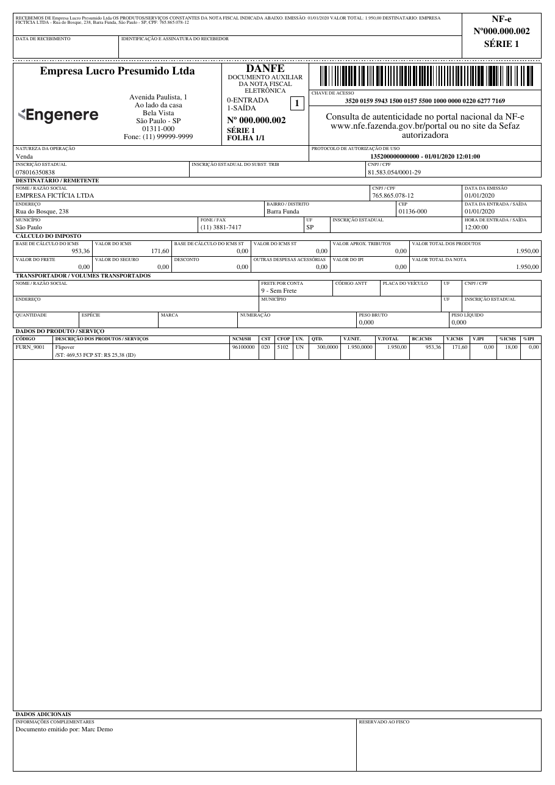

DANFE (Auxiliary Document of the Electronic Invoice) is a printed representation of the NF-e (Electronic Invoice) used in Brazil. It contains key details about the transaction, such as the seller, buyer, products, and taxes.

{ width="480" }

The layout follows the reference model of Technical Note **NT 2026.010 (DANFE Reforma Tributária)**, which adds the IBS, CBS and Selective Tax (IS) of the Brazilian consumption tax reform (RTC) to the DANFE. NF-e issued before December 1, 2026, when the NT goes into production, keep the previous layout (MOC 7.0); see [Layout transition](#layout-transition).

[Try it online with a sample XML :material-arrow-right:](https://brazilfiscalreport.streamlit.app/?exemplo=danfe){ .md-button }

## Basic Usage

=== "Python"

    ```python
    from brazilfiscalreport.danfe import Danfe

    # Path to the XML file
    xml_file_path = 'nfe.xml'

    # Load XML Content
    with open(xml_file_path, "r", encoding="utf8") as file:
        xml_content = file.read()

    # Instantiate the DANFE object with the loaded XML content
    danfe = Danfe(xml=xml_content)
    danfe.output('output_danfe.pdf')
    ```

=== "CLI"

    ```bash
    bfrep danfe /path/to/nfe.xml
    ```

## Layout transition

NT 2026.010 changes the DANFE layout on December 1, 2026, with no transition period. The `layout` option of `DanfeConfig` picks the layout:

| Value | Layout |
|---|---|
| `DanfeLayout.AUTO` (default) | The one in force on the NF-e issue date (`dhEmi`, Brasília time): MOC 7.0 before December 1, 2026, NT 2026.010 from then on. |
| `DanfeLayout.NT_2026_010` | NT 2026.010 for any NF-e. |
| `DanfeLayout.MOC_7_0` | MOC 7.0 for any NF-e. Deprecated. |

Since `AUTO` follows the issue date, the same XML always gives the same DANFE: a reprint of an NF-e issued in November keeps the previous layout.

To try the new layout before the date:

```python
from brazilfiscalreport.danfe import Danfe, DanfeConfig, DanfeLayout

config = DanfeConfig(layout=DanfeLayout.NT_2026_010)
danfe = Danfe(xml_content, config=config)
```

!!! warning "Before December 1, 2026"
    `DanfeLayout.NT_2026_010` is meant for testing and for NF-e issued in homologation (`tpAmb` = 2). Until December 1, 2026 the DANFE manual in force is the MOC 7.0 (Anexo II), which does not allow suppressing columns such as NCM and the ICMS base, value and rate (item 3.1.7); the new layout moves them. In production, keep `AUTO`.

!!! note "Removal of the previous layout"
    The MOC 7.0 layout is kept only for the transition and will be removed in a future version. From then on, every NF-e is printed in the NT 2026.010 layout. `DanfeLayout.MOC_7_0` emits a `DeprecationWarning`.

## Customizing DANFE 🎨

This section describes how to customize the PDF output of the DANFE using the `DanfeConfig` class. You can adjust various settings such as margins, fonts, and watermarks according to your needs.

### Configuration Options ⚙️

Here is a breakdown of all the configuration options available in `DanfeConfig`:

---

**Logo**

- **Type**: `str`, `BytesIO`, or `bytes`
- **Description**: Path to the logo file or binary image data to be included in the PDF. You can use a file path string or pass image data directly.
- **Example**:
    ```python
    config.logo = "path/to/logo.jpg"  # Using a file path
    ```
- **Default**: No logo.

---

**Margins**

- **Type**: `Margins`
- **Fields**: `top`, `right`, `bottom`, `left` (all of type `Number`)
- **Description**: Sets the page margins for the PDF document, in millimeters.
- **Example**:
    ```python
    config.margins = Margins(top=5, right=5, bottom=5, left=5)
    ```
- **Default**: top, right, bottom, and left are set to 5 mm.

---

**Font Type**

- **Type**: `FontType` (Enum)
- **Values**: `COURIER`, `TIMES`
- **Description**: Font style used throughout the PDF document.
- **Example**:
    ```python
    config.font_type = FontType.COURIER
    ```
- **Default**: `TIMES`

---

**Font Size**

- **Type**: `FontSize` (Enum)
- **Values**: `BIG`, `SMALL`
- **Description**: Font size used throughout the PDF document. The values are multipliers applied to the base sizes (`SMALL` = 1.0, `BIG` = 1.35).
- **Example**:
    ```python
    config.font_size = FontSize.BIG
    ```
- **Default**: `SMALL`

!!! note
    `FontSize.BIG` only takes effect with `FontType.TIMES`; with `COURIER` the `SMALL` size is always used.

---

**Receipt Position**

- **Type**: `ReceiptPosition` (Enum)
- **Values**: `TOP`, `BOTTOM`, `LEFT`
- **Description**: Position of the receipt section in the DANFE.
- **Example**:
    ```python
    config.receipt_pos = ReceiptPosition.BOTTOM
    ```
- **Default**: `TOP` when portrait, `LEFT` when landscape orientation.

!!! note
    The page orientation is determined automatically by the `tpImp` tag of the NF-e XML (`2` = landscape, any other value = portrait) and is not configurable. In landscape orientation, the receipt position is forced to the far left; customization is not permitted.

---

**Carrier Receipt**

- **Type**: `bool`
- **Description**: When set to `True`, prints an extra receipt (*canhoto de coleta*) for the carrier to sign when picking up the goods, in addition to the regular delivery receipt (*canhoto de entrega*). The extra receipt is only printed when the NF-e has a carrier (`transporta`) informed. The collection receipt is placed at the page edge (the outermost one), so the carrier can detach it without removing the delivery receipt; each receipt is identified in its text and signature labels.
- **Example**:
    ```python
    config.carrier_receipt = True
    ```
- **Default**: `False`

---

**Decimal Configuration**

- **Type**: `DecimalConfig`
- **Fields**: `price_precision`, `quantity_precision` (both `int`)
- **Description**: Defines the number of decimal places for prices and quantities.
- **Example**:
    ```python
    config.decimal_config = DecimalConfig(price_precision=2, quantity_precision=2)
    ```
- **Default**: `4` for both `price_precision` and `quantity_precision`.

---

**Tax Configuration**

- **Type**: `TaxConfiguration` (Enum)
- **Values**: `STANDARD_ICMS_IPI`, `ICMS_ST`, `WITHOUT_IPI`
- **Description**: Specifies which tax fields to display.
- **Example**:
    ```python
    config.tax_configuration = TaxConfiguration.WITHOUT_IPI
    ```
- **Default**: `STANDARD_ICMS_IPI`

!!! warning
    This feature is not yet implemented; setting it currently has no effect on the output.

---

**Invoice Display**

- **Type**: `InvoiceDisplay` (Enum)
- **Values**: `DUPLICATES_ONLY`, `FULL_DETAILS`
- **Description**: Controls the level of detail in the invoice section of the DANFE.
- **Example**:
    ```python
    config.invoice_display = InvoiceDisplay.FULL_DETAILS
    ```
- **Default**: `FULL_DETAILS`

---

**Display PIS COFINS**

- **Type**: `bool`
- **Values**: `True`, `False`
- **Description**: Whether or not to display PIS and COFINS taxes in the DANFE totals.
- **Example**:
    ```python
    config.display_pis_cofins = True
    ```
- **Default**: `False`

---

**Line break in supplementary information**

- **Type**: `bool`
- **Values**: `True`, `False`
- **Description**: Break the line on each `";"` found in the supplementary information (`infCpl`) of the DANFE.
- **Example**:
    ```python
    config.infcpl_semicolon_newline = True
    ```
- **Default**: `False`

---

**Product Description Config**

- **Type**: `ProductDescriptionConfig`
- **Fields**: `display_branch` (`bool`), `display_anp` (`bool`), `display_anvisa` (`bool`), `branch_info_prefix` (`str`), `display_additional_info` (`bool`), `display_xped` (`bool`)
- **Description**: Controls what additional information is displayed in the product description column of the DANFE. `display_xped` prints the purchase order of the item (`xPed`, plus `nItemPed` when present), e.g. "Pedido: 4500012345 Item: 10".
- **Example**:
    ```python
    config.product_description_config = ProductDescriptionConfig(
        display_branch=True,
        branch_info_prefix="=>",
        display_additional_info=True,
        display_anp=True,
        display_anvisa=True,
        display_xped=True,
    )
    ```
- **Default**:
    ```python
    ProductDescriptionConfig(
        display_branch=False,
        display_anp=False,
        display_anvisa=False,
        branch_info_prefix="",
        display_additional_info=True,
        display_xped=False,
    )
    ```

---

**Watermark Cancelled**

- **Type**: `bool`
- **Description**: When set to `True`, displays a "CANCELADA" watermark on the DANFE for cancelled invoices. If the XML belongs to the homologation environment, the text becomes "CANCELADA - SEM VALOR FISCAL".
- **Example**:
    ```python
    config.watermark_cancelled = True
    ```
- **Default**: `False`

!!! note
    Independently of this setting, a "SEM VALOR FISCAL" watermark is drawn automatically whenever the XML has no authorization protocol (`protNFe`) or was issued in the homologation environment (`tpAmb` = 2). When `watermark_cancelled=True`, the cancellation watermark takes precedence.

---

**Footer Stamp**

- **Type**: `FooterStamp`
- **Fields**:
    - `logo` (`Optional[Union[str, BytesIO, bytes]]`): logo image; default `None`.
    - `text` (`str`): text rendered to the left of the logo; default `""`.
    - `height` (`Number`): vertical area, in mm, reserved for the stamp; default `5`.
    - `logo_max_width` (`Number`): bounding-box width, in mm, used to fit the logo while preserving aspect ratio; default `20`.
    - `spacing` (`Number`): vertical gap, in mm, between the content area and the stamp; default `1`.
- **Description**: Renders a custom stamp (logo + text) on every page of the invoice, right-aligned to the page margin. The stamp area is automatically reserved inside the bottom margin — there is no need to enlarge `Margins.bottom` to make room for it.
- **Example**:
    ```python
    config.footer_stamp = FooterStamp(
        logo="path/to/logo.png",
        text="Powered by",
    )
    ```
- **Default**: `FooterStamp()` (empty — nothing is rendered).

---

**Layout**

- **Type**: `DanfeLayout` (Enum)
- **Values**: `AUTO`, `NT_2026_010`, `MOC_7_0`
- **Description**: DANFE layout. `AUTO` picks the one in force on the NF-e issue date; see [Layout transition](#layout-transition).
- **Example**:
    ```python
    config.layout = DanfeLayout.NT_2026_010
    ```
- **Default**: `AUTO`

---

### Usage Example with Customization

Here's how to set up a `DanfeConfig` object with a full set of customizations:

```python
from brazilfiscalreport.danfe import (
    Danfe,
    DanfeConfig,
    DecimalConfig,
    FontType,
    FooterStamp,
    InvoiceDisplay,
    Margins,
    ProductDescriptionConfig,
    ReceiptPosition,
)

# Path to the XML file
xml_file_path = 'nfe.xml'

# Load XML Content
with open(xml_file_path, "r", encoding="utf8") as file:
    xml_content = file.read()

# Create a configuration instance
config = DanfeConfig(
    logo='path/to/logo.png',
    margins=Margins(top=10, right=10, bottom=10, left=10),
    receipt_pos=ReceiptPosition.BOTTOM,
    decimal_config=DecimalConfig(price_precision=2, quantity_precision=2),
    invoice_display=InvoiceDisplay.FULL_DETAILS,
    font_type=FontType.TIMES,
    display_pis_cofins=True,
    product_description_config=ProductDescriptionConfig(
        display_branch=True,
        display_additional_info=True,
    ),
    footer_stamp=FooterStamp(
        logo='path/to/footer_logo.png',
        text='Powered by',
    ),
)

# Use this config when creating a Danfe instance
danfe = Danfe(xml_content, config=config)
danfe.output('output_danfe.pdf')
```

## NT 2026.010 layout notes

- The header shows the **Código do Regime Tributário** (`CRT`) and reserves the **Tipo de Regime de Apuração do IBS e da CBS** field, which stays blank until a future NT defines its XML tag (NT 2026.010, item 4.2).
- The totals are split in **Total dos Produtos e Total da Nota**, **Total do ICMS / IPI** and **Total do IBS / CBS / IS** (item 4.1). The FCP/DIFAL and single-phase ICMS lines are printed only when one of their values is not zero, and the single-phase IBS/CBS line only when the `gMono` group is informed (item 4.4).
- The **Cálculo do ISSQN** block comes before the carrier block and is printed only when `ISSQNtot` is informed; the carrier address and volume lines are printed only when the NF-e has them.
- When the NF-e has several `vol` groups, the volume line (in both layouts) sums the quantity and the gross and net weights, and lists the distinct species, brands and numbering separated by commas.
- Each item shows the CST/CFOP, the NCM and the `cClassTrib` at the bottom of the description, and the **bases, rates and values** of ICMS, IBS UF, IBS Município, CBS, IPI and IS (item 4.3). Only the taxes informed in the item are listed; rates and values are printed two per line (ICMS / CBS, IBS UF / IPI, IBS MUN / IS) when they fit, otherwise one per line.
- When the `gRed` group is informed (rate reduction or government purchase), the effective rate `pAliqEfet` is printed for IBS UF, IBS Município and CBS instead of the regular rate.
- Values absent from the XML are left blank instead of being printed as zero (item 4.4).
- When the XML has `infNFeSupl/qrCode`, a **QR Code** box is printed beside **Dados Adicionais** (item 4.5). While the rules for the QR Code of the regular DANFE are not published, it follows NT 2026.003 (DANFE Simplificado Tipo 2): 22 mm of code inside a 25 x 25 mm box and error correction level M.
