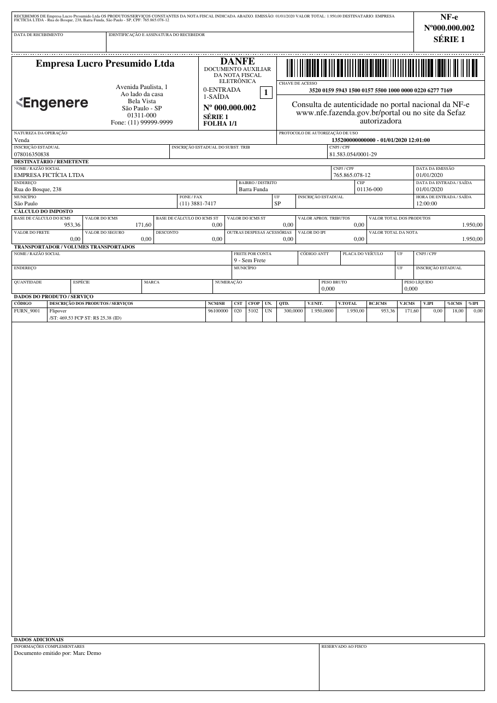

DANFE (Documento Auxiliar da Nota Fiscal Eletrônica) é uma representação impressa da NF-e (Nota Fiscal Eletrônica) usada no Brasil. Contém os principais detalhes da transação, como vendedor, comprador, produtos e impostos.

{ width="480" }

O leiaute segue o modelo de referência da Nota Técnica **NT 2026.010 (DANFE Reforma Tributária)**, que inclui no DANFE o IBS, a CBS e o Imposto Seletivo (IS) da Reforma Tributária do Consumo (RTC). NF-e emitidas antes de 1º de dezembro de 2026, quando a NT entra em produção, mantêm o leiaute anterior (MOC 7.0); veja [Transição de leiaute](#transicao-de-leiaute).

[Teste online com um XML de exemplo :material-arrow-right:](https://brazilfiscalreport.streamlit.app/?exemplo=danfe){ .md-button }

## Uso Básico

=== "Python"

    ```python
    from brazilfiscalreport.danfe import Danfe

    # Caminho para o arquivo XML
    xml_file_path = 'nfe.xml'

    # Carregar conteúdo do XML
    with open(xml_file_path, "r", encoding="utf8") as file:
        xml_content = file.read()

    # Instanciar o objeto DANFE com o conteúdo XML carregado
    danfe = Danfe(xml=xml_content)
    danfe.output('output_danfe.pdf')
    ```

=== "CLI"

    ```bash
    bfrep danfe /path/to/nfe.xml
    ```

## Transição de leiaute

A NT 2026.010 muda o leiaute do DANFE em 1º de dezembro de 2026, sem período de transição. A opção `layout` do `DanfeConfig` escolhe o leiaute:

| Valor | Leiaute |
|---|---|
| `DanfeLayout.AUTO` (padrão) | O vigente na data de emissão da NF-e (`dhEmi`, horário de Brasília): MOC 7.0 antes de 1º de dezembro de 2026, NT 2026.010 a partir dessa data. |
| `DanfeLayout.NT_2026_010` | NT 2026.010 para qualquer NF-e. |
| `DanfeLayout.MOC_7_0` | MOC 7.0 para qualquer NF-e. Obsoleto. |

Como o `AUTO` segue a data de emissão, o mesmo XML gera sempre o mesmo DANFE: a reimpressão de uma NF-e emitida em novembro mantém o leiaute anterior.

Para testar o leiaute novo antes da data:

```python
from brazilfiscalreport.danfe import Danfe, DanfeConfig, DanfeLayout

config = DanfeConfig(layout=DanfeLayout.NT_2026_010)
danfe = Danfe(xml_content, config=config)
```

!!! warning "Antes de 1º de dezembro de 2026"
    O `DanfeLayout.NT_2026_010` serve para testes e para NF-e emitidas em homologação (`tpAmb` = 2). Até 1º de dezembro de 2026 vale o Manual do DANFE do MOC 7.0 (Anexo II), que não permite suprimir colunas como NCM e base, valor e alíquota do ICMS (item 3.1.7); o leiaute novo as remaneja. Em produção, mantenha o `AUTO`.

!!! note "Remoção do leiaute anterior"
    O leiaute do MOC 7.0 existe só durante a transição e será removido em uma versão futura. A partir daí, toda NF-e sai no leiaute da NT 2026.010. O `DanfeLayout.MOC_7_0` emite um `DeprecationWarning`.

## Personalizando o DANFE 🎨

Esta seção descreve como personalizar a saída PDF do DANFE usando a classe `DanfeConfig`. Você pode ajustar diversas configurações como margens, fontes e marcas d'água de acordo com suas necessidades.

### Opções de Configuração ⚙️

Aqui está uma descrição de todas as opções de configuração disponíveis em `DanfeConfig`:

---

**Logo**

- **Tipo**: `str`, `BytesIO` ou `bytes`
- **Descrição**: Caminho para o arquivo de logo ou dados binários da imagem a ser incluída no PDF. Você pode usar uma string com o caminho do arquivo ou passar os dados da imagem diretamente.
- **Exemplo**:
    ```python
    config.logo = "path/to/logo.jpg"  # Usando caminho do arquivo
    ```
- **Padrão**: Sem logo.

---

**Margens**

- **Tipo**: `Margins`
- **Campos**: `top`, `right`, `bottom`, `left` (todos do tipo `Number`)
- **Descrição**: Define as margens da página do documento PDF, em milímetros.
- **Exemplo**:
    ```python
    config.margins = Margins(top=5, right=5, bottom=5, left=5)
    ```
- **Padrão**: top, right, bottom e left definidos como 5 mm.

---

**Tipo de Fonte**

- **Tipo**: `FontType` (Enum)
- **Valores**: `COURIER`, `TIMES`
- **Descrição**: Estilo de fonte usado em todo o documento PDF.
- **Exemplo**:
    ```python
    config.font_type = FontType.COURIER
    ```
- **Padrão**: `TIMES`

---

**Tamanho da Fonte**

- **Tipo**: `FontSize` (Enum)
- **Valores**: `BIG`, `SMALL`
- **Descrição**: Tamanho da fonte usado em todo o documento PDF. Os valores são multiplicadores aplicados sobre os tamanhos base (`SMALL` = 1.0, `BIG` = 1.35).
- **Exemplo**:
    ```python
    config.font_size = FontSize.BIG
    ```
- **Padrão**: `SMALL`

!!! note
    `FontSize.BIG` só tem efeito com `FontType.TIMES`; com `COURIER` o tamanho `SMALL` é sempre usado.

---

**Posição do Recibo**

- **Tipo**: `ReceiptPosition` (Enum)
- **Valores**: `TOP`, `BOTTOM`, `LEFT`
- **Descrição**: Posição da seção de recibo no DANFE.
- **Exemplo**:
    ```python
    config.receipt_pos = ReceiptPosition.BOTTOM
    ```
- **Padrão**: `TOP` quando retrato, `LEFT` quando orientação paisagem.

!!! note
    A orientação da página é determinada automaticamente pela tag `tpImp` do XML da NF-e (`2` = paisagem, qualquer outro valor = retrato) e não é configurável. Na orientação paisagem, a posição do recibo é forçada para o lado esquerdo; personalização não é permitida.

---

**Canhoto do Transportador**

- **Tipo**: `bool`
- **Descrição**: Quando definido como `True`, imprime um canhoto extra (canhoto de coleta) para o transportador assinar ao coletar a mercadoria, além do canhoto de entrega. O canhoto extra só é impresso quando a NF-e possui transportadora (`transporta`) informada. O canhoto de coleta fica na borda da página (o mais externo), para que o transportador possa destacá-lo sem remover o canhoto de entrega; cada canhoto é identificado no texto e nos rótulos de assinatura.
- **Exemplo**:
    ```python
    config.carrier_receipt = True
    ```
- **Padrão**: `False`

---

**Configuração Decimal**

- **Tipo**: `DecimalConfig`
- **Campos**: `price_precision`, `quantity_precision` (ambos `int`)
- **Descrição**: Define o número de casas decimais para preços e quantidades.
- **Exemplo**:
    ```python
    config.decimal_config = DecimalConfig(price_precision=2, quantity_precision=2)
    ```
- **Padrão**: `4` para `price_precision` e `quantity_precision`.

---

**Configuração de Impostos**

- **Tipo**: `TaxConfiguration` (Enum)
- **Valores**: `STANDARD_ICMS_IPI`, `ICMS_ST`, `WITHOUT_IPI`
- **Descrição**: Especifica quais campos de impostos exibir.
- **Exemplo**:
    ```python
    config.tax_configuration = TaxConfiguration.WITHOUT_IPI
    ```
- **Padrão**: `STANDARD_ICMS_IPI`

!!! warning
    Este recurso ainda não foi implementado; defini-lo atualmente não tem efeito na saída.

---

**Exibição da Fatura**

- **Tipo**: `InvoiceDisplay` (Enum)
- **Valores**: `DUPLICATES_ONLY`, `FULL_DETAILS`
- **Descrição**: Controla o nível de detalhe na seção de fatura do DANFE.
- **Exemplo**:
    ```python
    config.invoice_display = InvoiceDisplay.FULL_DETAILS
    ```
- **Padrão**: `FULL_DETAILS`

---

**Exibir PIS COFINS**

- **Tipo**: `bool`
- **Valores**: `True`, `False`
- **Descrição**: Define se os impostos PIS e COFINS devem ser exibidos nos totais do DANFE.
- **Exemplo**:
    ```python
    config.display_pis_cofins = True
    ```
- **Padrão**: `False`

---

**Quebra de linha nas informações complementares**

- **Tipo**: `bool`
- **Valores**: `True`, `False`
- **Descrição**: Quebra a linha em cada `";"` encontrado nas informações complementares (`infCpl`) do DANFE.
- **Exemplo**:
    ```python
    config.infcpl_semicolon_newline = True
    ```
- **Padrão**: `False`

---

**Configuração da Descrição do Produto**

- **Tipo**: `ProductDescriptionConfig`
- **Campos**: `display_branch` (`bool`), `display_anp` (`bool`), `display_anvisa` (`bool`), `branch_info_prefix` (`str`), `display_additional_info` (`bool`), `display_xped` (`bool`)
- **Descrição**: Controla quais informações adicionais são exibidas na coluna de descrição do produto do DANFE. O `display_xped` imprime o pedido de compra do item (`xPed`, e o `nItemPed` quando houver), por exemplo "Pedido: 4500012345 Item: 10".
- **Exemplo**:
    ```python
    config.product_description_config = ProductDescriptionConfig(
        display_branch=True,
        branch_info_prefix="=>",
        display_additional_info=True,
        display_anp=True,
        display_anvisa=True,
        display_xped=True,
    )
    ```
- **Padrão**:
    ```python
    ProductDescriptionConfig(
        display_branch=False,
        display_anp=False,
        display_anvisa=False,
        branch_info_prefix="",
        display_additional_info=True,
        display_xped=False,
    )
    ```

---

**Marca d'água Cancelada**

- **Tipo**: `bool`
- **Descrição**: Quando definido como `True`, exibe uma marca d'água "CANCELADA" no DANFE para notas fiscais canceladas. Se o XML for do ambiente de homologação, o texto passa a ser "CANCELADA - SEM VALOR FISCAL".
- **Exemplo**:
    ```python
    config.watermark_cancelled = True
    ```
- **Padrão**: `False`

!!! note
    Independentemente desta configuração, uma marca d'água "SEM VALOR FISCAL" é desenhada automaticamente sempre que o XML não tem protocolo de autorização (`protNFe`) ou foi emitido em ambiente de homologação (`tpAmb` = 2). Quando `watermark_cancelled=True`, a marca de cancelamento tem precedência.

---

**Carimbo de Rodapé (Footer Stamp)**

- **Tipo**: `FooterStamp`
- **Campos**:
    - `logo` (`Optional[Union[str, BytesIO, bytes]]`): imagem do logo; padrão `None`.
    - `text` (`str`): texto exibido à esquerda do logo; padrão `""`.
    - `height` (`Number`): área vertical, em mm, reservada para o carimbo; padrão `5`.
    - `logo_max_width` (`Number`): largura, em mm, da caixa usada para encaixar o logo preservando a proporção; padrão `20`.
    - `spacing` (`Number`): espaçamento vertical, em mm, entre a área de conteúdo e o carimbo; padrão `1`.
- **Descrição**: Desenha um carimbo personalizado (logo + texto) em todas as páginas da nota, alinhado à direita na margem da página. A área do carimbo é reservada automaticamente dentro da margem inferior — não é necessário aumentar `Margins.bottom` para abrir espaço.
- **Exemplo**:
    ```python
    config.footer_stamp = FooterStamp(
        logo="path/to/logo.png",
        text="Powered by",
    )
    ```
- **Padrão**: `FooterStamp()` (vazio — nada é desenhado).

---

**Leiaute**

- **Tipo**: `DanfeLayout` (Enum)
- **Valores**: `AUTO`, `NT_2026_010`, `MOC_7_0`
- **Descrição**: Leiaute do DANFE. O `AUTO` escolhe o vigente na data de emissão da NF-e; veja [Transição de leiaute](#transicao-de-leiaute).
- **Exemplo**:
    ```python
    config.layout = DanfeLayout.NT_2026_010
    ```
- **Padrão**: `AUTO`

---

### Exemplo de Uso com Personalização

Veja como configurar um objeto `DanfeConfig` com um conjunto completo de personalizações:

```python
from brazilfiscalreport.danfe import (
    Danfe,
    DanfeConfig,
    DecimalConfig,
    FontType,
    FooterStamp,
    InvoiceDisplay,
    Margins,
    ProductDescriptionConfig,
    ReceiptPosition,
)

# Caminho para o arquivo XML
xml_file_path = 'nfe.xml'

# Carregar conteúdo do XML
with open(xml_file_path, "r", encoding="utf8") as file:
    xml_content = file.read()

# Criar uma instância de configuração
config = DanfeConfig(
    logo='path/to/logo.png',
    margins=Margins(top=10, right=10, bottom=10, left=10),
    receipt_pos=ReceiptPosition.BOTTOM,
    decimal_config=DecimalConfig(price_precision=2, quantity_precision=2),
    invoice_display=InvoiceDisplay.FULL_DETAILS,
    font_type=FontType.TIMES,
    display_pis_cofins=True,
    product_description_config=ProductDescriptionConfig(
        display_branch=True,
        display_additional_info=True,
    ),
    footer_stamp=FooterStamp(
        logo='path/to/footer_logo.png',
        text='Powered by',
    ),
)

# Usar esta configuração ao criar uma instância do Danfe
danfe = Danfe(xml_content, config=config)
danfe.output('output_danfe.pdf')
```

## Notas sobre o leiaute da NT 2026.010

- O cabeçalho exibe o **Código do Regime Tributário** (`CRT`) e reserva o campo **Tipo de Regime de Apuração do IBS e da CBS**, que fica em branco até uma NT futura definir a tag do XML (NT 2026.010, item 4.2).
- Os totais são divididos em **Total dos Produtos e Total da Nota**, **Total do ICMS / IPI** e **Total do IBS / CBS / IS** (item 4.1). As linhas de FCP/DIFAL e de ICMS monofásico só são impressas quando algum dos seus valores é diferente de zero, e a linha de IBS/CBS monofásicos só quando o grupo `gMono` é informado (item 4.4).
- O bloco **Cálculo do ISSQN** vem antes do bloco do transportador e só é impresso quando `ISSQNtot` é informado; as linhas de endereço do transportador e de volumes só são impressas quando a NF-e as possui.
- Quando a NF-e tem vários grupos `vol`, a linha de volumes (nos dois leiautes) soma a quantidade e os pesos bruto e líquido, e lista as espécies, marcas e numerações distintas separadas por vírgula.
- Cada item exibe o CST/CFOP, o NCM e o `cClassTrib` no rodapé da descrição, e as **bases, alíquotas e valores** de ICMS, IBS UF, IBS Município, CBS, IPI e IS (item 4.3). Só os tributos informados no item são listados; alíquotas e valores são impressos dois por linha (ICMS / CBS, IBS UF / IPI, IBS MUN / IS) quando cabem, senão um por linha.
- Quando o grupo `gRed` é informado (redução de alíquota ou compra governamental), é impressa a alíquota efetiva `pAliqEfet` do IBS UF, do IBS Município e da CBS no lugar da alíquota vigente.
- Valores ausentes do XML ficam em branco em vez de impressos como zero (item 4.4).
- Quando o XML possui `infNFeSupl/qrCode`, um quadro de **QR Code** é impresso ao lado de **Dados Adicionais** (item 4.5). Enquanto as regras do QR Code do DANFE comum não são publicadas, ele segue a NT 2026.003 (DANFE Simplificado Tipo 2): 22 mm de código num quadro de 25 x 25 mm e nível de correção de erros M.
